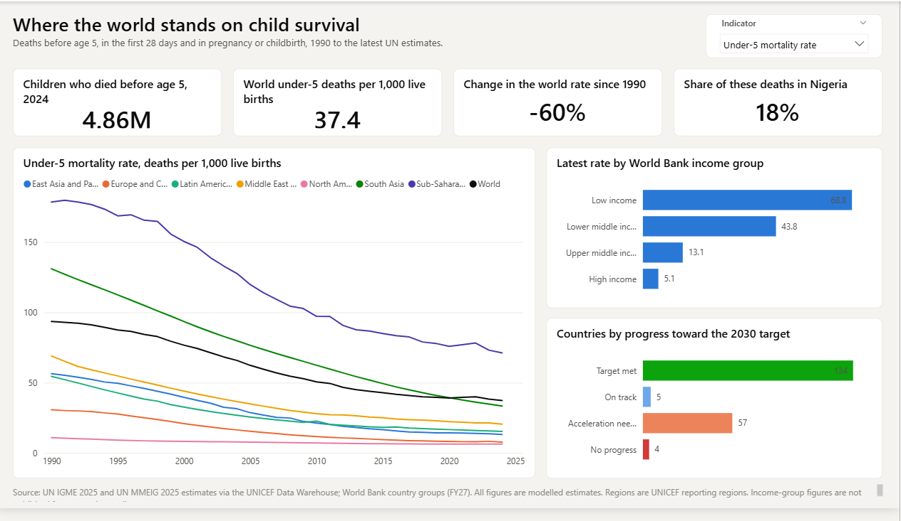
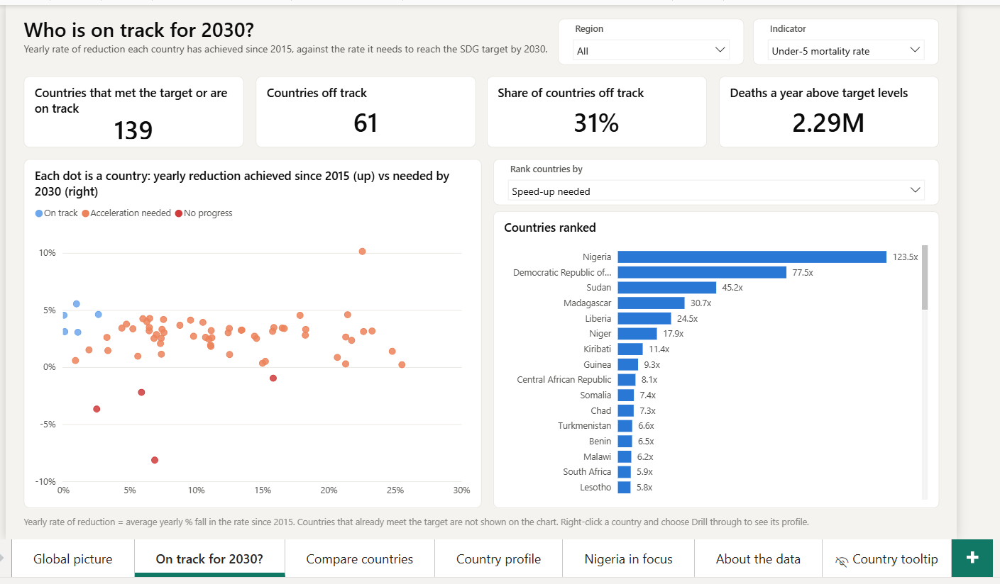
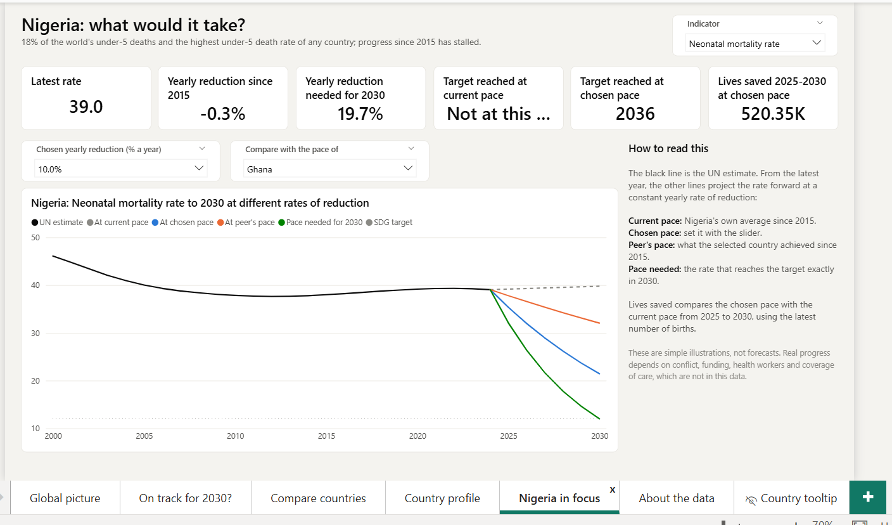

# Child Survival 2030

An interactive Power BI dashboard on child and maternal deaths in 200 countries, 1990 to the latest UN estimates, measured against the Sustainable Development Goal (SDG) targets for 2030.

**The question:** which countries will meet the 2030 targets for child and maternal survival, and how much faster do the others need to move? See the [project brief](Project_Brief.pdf) for the plan, methods and limitations.



## What the data says

- In 2024, **4.86 million children died before their fifth birthday**, down from 12.97 million in 1990. The world under-5 death rate fell 60%, from 93.5 to 37.4 per 1,000 live births.
- **Newborns are being left behind.** 2.27 million of those deaths (47%) happened in the first 28 days of life, and the newborn death rate has fallen more slowly (36.6 to 17.2 per 1,000) than the under-5 rate.
- **61 of 200 countries are off track** for the under-5 target of 25 per 1,000 by 2030. 67 are off track for the newborn target and 68 for maternal mortality.
- **Nigeria has the highest under-5 death rate of any country (116 per 1,000) and 18% of the world's under-5 deaths** (about 856,000 in 2024).
- Nigeria's progress has **stalled since 2015**: the under-5 rate has fallen by 0.2% a year, against 25.5% a year needed to reach the target by 2030. Its newborn death rate has not fallen at all.
- At a steady 10% a year, Nigeria would reach the under-5 target around 2040, and about 1.45 million fewer children would die between 2025 and 2030 than at its current pace. This is a simple illustration, not a forecast.

## Dashboard pages

| Page | What it answers |
|---|---|
| **Global picture** | How have under-5, newborn and maternal death rates changed since 1990, by region and income group? How many countries are on track? |
| **On track for 2030?** | The yearly rate of reduction each country has achieved since 2015 against the rate it needs, and a ranking you can switch between seven measures. |
| **Compare countries** | Every country's rate in 1990, 2015 and the latest year, with change and yearly reduction, next to its status and outlook. |
| **Country profile** | Right-click any country and choose *Drill through*: trends with uncertainty ranges, the target line and progress on all three targets. |
| **Nigeria in focus** | What it would take: projections to 2030 at the current pace, a chosen pace (slider), a peer country's pace and the pace needed. |
| **About the data** | Sources, definitions, methods and limitations. |

A five-step guided story is saved as bookmarks (**View > Bookmarks**), and hovering over a country shows its trend in a tooltip.





## Data

| Source | What it provides |
|---|---|
| [UN IGME](https://childmortality.org/) 2025 estimates, via the [UNICEF Data Warehouse](https://data.unicef.org/) | Under-5, infant and neonatal mortality rates and deaths, stillbirths, 1990-2024, with 90% uncertainty ranges |
| UN MMEIG 2025 estimates, via the UNICEF Data Warehouse | Maternal mortality ratio, 2000-2023 |
| UN World Population Prospects, via the UNICEF Data Warehouse | Births and population |
| [World Bank country groups](https://datahelpdesk.worldbank.org/knowledgebase/articles/906519-world-bank-country-and-lending-groups) (FY27) | Each country's region and income group |

Downloaded October 2026. All figures are modelled estimates, not direct counts.

### SDG targets

- **SDG 3.2:** under-5 mortality 25 or less, and neonatal mortality 12 or less, per 1,000 live births by 2030.
- **SDG 3.1:** global maternal mortality below 70 per 100,000 live births. This is a global target; the dashboard uses 70 as a benchmark for each country.

## Methods

- **Yearly rate of reduction (ARR)**, the UN IGME measure of progress:
  `ARR = ln(rate in 2015 / latest rate) / (latest year - 2015)`
- **Needed ARR** to reach the target by 2030:
  `ln(latest rate / target) / (2030 - latest year)`
- **Status:** *target met*; *on track* (achieved ARR at least the needed ARR); *acceleration needed* (falling, but too slowly); *no progress* (no fall since 2015).
- **Projections** apply a constant ARR from the latest year. The year a target would be reached is shown in bands (by 2030, 2031-2050, 2051-2100, after 2100).
- **Regional, income group and world figures** are the official UN aggregates, weighted by births, never averages of country rates.
- **Crisis flag:** UN IGME counts deaths from conflicts and disasters. South Sudan's rate, for example, rose from 97 to 292 during the 2014-2017 conflict, which makes "progress since 2015" look better than it is. Ten countries with a jump of more than 20% in a year since 2014 are flagged rather than changed.

## Limitations

- Where death registration is weak, including Nigeria, the estimates rest on surveys and models and carry wide uncertainty (Nigeria's 2024 under-5 rate: 116, range 99 to 136).
- Maternal mortality has no uncertainty range in this data and ends in 2023; child mortality ends in 2024.
- The World Bank regional rows in the UNICEF download carry no mortality figures, so regional trends use **UNICEF reporting regions**, while each country's region label comes from the World Bank's FY27 groups. Income-group figures are not published for maternal mortality.
- Projections assume a constant pace. Real progress depends on conflict, health financing, health workers and coverage of care, which are not in this data.

## How it's built

```
data/raw/               UNICEF Data Warehouse CSV and World Bank country groups, unchanged
data/clean/             tidy tables loaded by Power BI
scripts/clean.py        cleaning, progress calculations and crisis flags
scripts/make_model.py   writes the semantic model (tables, relationships, 47 DAX measures)
scripts/make_report.py  writes the report pages, theme, drill-through and tooltip page
powerbi/                Power BI project (.pbip): model and report as text files
Project_Brief.pdf       the project brief (Word version: Project_Brief.docx)
```

Power BI techniques used, each for a reason:

- **Field parameter:** one ranking chart, switchable between seven measures (latest rate, change since 2015, yearly reduction achieved or needed, speed-up needed, gap to target, deaths above target).
- **Calculation group:** one rate measure shown as 1990, 2015, latest, change since 1990 and 2015, and yearly reduction, written once.
- **What-if parameter and a peer-country table** for the Nigeria scenarios.
- **Drill-through** to a country profile, a **report-page tooltip**, **bookmarks** for a guided story, uncertainty ranges, conditional formatting by status and dynamic titles.
- **Power BI project format (PBIP):** the model is TMDL and the report is JSON, generated by Python, so every change is reviewable in Git and the whole report can be rebuilt from the scripts.

## Running it yourself

1. Install [Power BI Desktop](https://powerbi.microsoft.com/desktop/) (Windows) and Python 3 with pandas and openpyxl.
2. Optional: rebuild everything with `python scripts/clean.py`, `python scripts/make_model.py` and `python scripts/make_report.py` (with Power BI closed).
3. Open `powerbi/child-survival-2030.pbip`.
4. Point the model at your copy of the data: **Transform data > Edit parameters > DataFolder**, set it to the full path of `data/clean/` (ending in `\`), then **Refresh**.

## License

The code (Python scripts and Power BI project) is released under the [MIT License](LICENSE). The data remains under the terms of its original sources (UN IGME / UNICEF, UN MMEIG, UN DESA and the World Bank), which are credited above.
